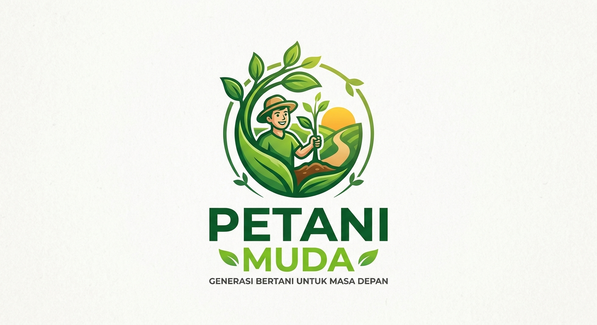
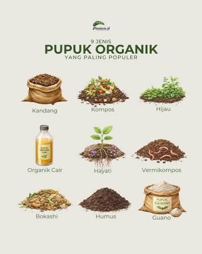
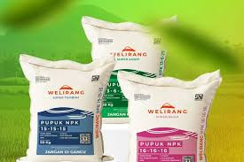
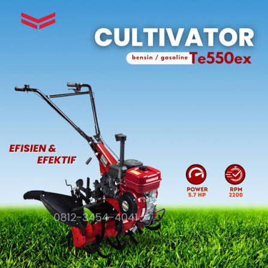
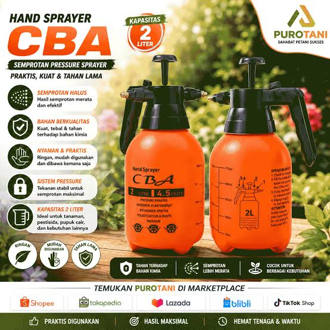
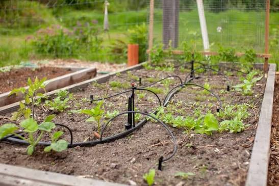
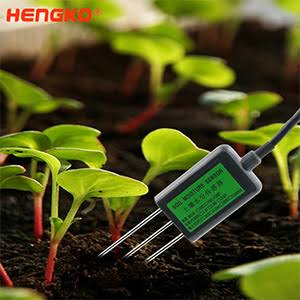

# PetaniMuda.id

**Solusi Pertanian Modern untuk Indonesia**

*Muda Berkarya, Petani Berdaya, Indonesia Jaya.*

[Lihat Produk](#produk-unggulan) · [Konsultasi via WhatsApp](https://wa.me/6283866268372?text=Halo%20PetaniMuda.id%2C%20saya%20ingin%20konsultasi%20produk%20pertanian.) · [Website](https://petanimuda.biz.id)

`Pupuk` · `Alat Pertanian` · `Smart Farming`

---

PetaniMuda.id hadir sebagai mitra petani Indonesia dalam menyediakan pupuk berkualitas, alat pertanian modern, dan teknologi Smart Farming untuk meningkatkan produktivitas serta efisiensi usaha tani.

## Tentang Kami

Pertanian merupakan sektor penting dalam kehidupan masyarakat Indonesia. Seiring perkembangan teknologi, kebutuhan akan pupuk berkualitas dan alat pertanian modern semakin meningkat. PetaniMuda.id menyediakan produk pertanian yang berkualitas, mudah diakses, dan sesuai dengan kebutuhan pertanian masa kini.

### Visi

Menjadi platform pertanian modern terpercaya yang mendukung kemajuan petani Indonesia.

### Misi

- Menyediakan produk pertanian berkualitas.
- Mendukung penggunaan teknologi pertanian.
- Meningkatkan produktivitas petani Indonesia.
- Memberikan edukasi pertanian modern.
- Mendukung pertanian berkelanjutan.

---

## Produk Unggulan

Enam produk dalam tiga kategori. Setiap produk punya tombol **Tanya via WhatsApp** yang pesannya sudah terisi nama produk.

| Foto | Kategori | Produk | Deskripsi |
| --- | --- | --- | --- |
|  | Pupuk | **Pupuk Organik** | Pupuk berbahan alami untuk menjaga kesuburan tanah dan meningkatkan kualitas hasil panen. |
|  | Pupuk | **Pupuk NPK** | Mengandung unsur hara lengkap untuk mendukung pertumbuhan tanaman yang optimal. |
|  | Alat Pertanian | **Traktor Mini** | Membantu pengolahan lahan lebih cepat, efisien, dan hemat tenaga. |
|  | Alat Pertanian | **Sprayer Elektrik** | Penyemprotan pupuk dan pestisida lebih cepat dan efisien. |
|  | Smart Farming | **Sistem Irigasi Tetes** | Menghemat penggunaan air dan meningkatkan efektivitas penyiraman. |
|  | Smart Farming | **Sensor Kelembaban Tanah** | Monitoring kondisi lahan secara real-time berbasis Smart Farming. |

---

## Fitur Website

- **Filter produk** per kategori: Pupuk, Alat Pertanian, dan Smart Farming.
- **Simulasi Smart Farming**: geser kelembaban tanah, lalu lihat status lahan dan pompa irigasi berubah.
- **Kalkulator pupuk**: hitung kebutuhan dari luas lahan dan dosis per hektar, lalu kirim hasilnya ke WhatsApp.
- **Visi dan Misi** dalam bentuk tab, serta **FAQ** yang bisa dibuka dan ditutup.
- **Form konsultasi** yang membuka WhatsApp dengan pesan yang sudah terisi.
- **Mode terang dan gelap**, dan tampilan yang nyaman di ponsel.

> Dosis awal pada kalkulator dan ambang 35% dan 70% pada simulasi hanya contoh. Sesuaikan dengan anjuran penyuluh atau hasil konsultasi untuk tanaman Anda.

---

## Keunggulan PetaniMuda.id

| | |
| --- | --- |
| **Produk berkualitas** | Produk berkualitas dan terpercaya untuk kebutuhan lahan Anda. |
| **Harga kompetitif** | Harga bersaing agar usaha tani tetap efisien. |
| **Pengiriman nasional** | Pengiriman ke seluruh Indonesia. |
| **Konsultasi pertanian** | Tanyakan kebutuhan lahan Anda langsung lewat WhatsApp. |
| **Teknologi Smart Farming** | Dukungan sensor, irigasi, dan alat modern untuk lahan Anda. |
| **Edukasi berkelanjutan** | Edukasi pertanian berkelanjutan untuk petani Indonesia. |

---

## Pertanyaan Umum

<b>Produk apa saja yang tersedia?</b>

Pupuk organik, pupuk NPK, traktor mini, sistem irigasi tetes, sensor kelembaban tanah, dan sprayer elektrik.

<b>Bagaimana cara memesan?</b>

Pilih produk di katalog, lalu tekan **Tanya via WhatsApp**. Pesan akan terisi nama produk, dan tim kami membalas dengan harga serta ketersediaan.

<b>Apakah bisa konsultasi sebelum membeli?</b>

Bisa. Kami melayani konsultasi pertanian lewat WhatsApp untuk membantu Anda memilih produk yang sesuai.

<b>Apakah pengiriman sampai luar pulau?</b>

Kami melayani pengiriman ke seluruh Indonesia. Hubungi kami lewat WhatsApp untuk menanyakan detail pengiriman ke daerah Anda.

<b>Apa itu Smart Farming?</b>

Smart Farming memanfaatkan sensor dan alat modern, misalnya sensor kelembaban tanah dan irigasi tetes, supaya penyiraman dan pemupukan lebih tepat dan efisien.

---

## Hubungi Kami

| | |
| --- | --- |
| **WhatsApp** | [+62 838-6626-8372](https://wa.me/6283866268372?text=Halo%20PetaniMuda.id%2C%20saya%20ingin%20konsultasi%20produk%20pertanian.) |
| **Email** | info@petanimuda.id |
| **Website** | [petanimuda.biz.id](https://petanimuda.biz.id) |
| **Instagram** | @petanimuda.id |
| **Facebook** | PetaniMuda.id |
| **TikTok** | @petanimuda.id |

---

**PetaniMuda.id**

*Muda Berkarya, Petani Berdaya, Indonesia Jaya.*

© 2026 PetaniMuda.id

